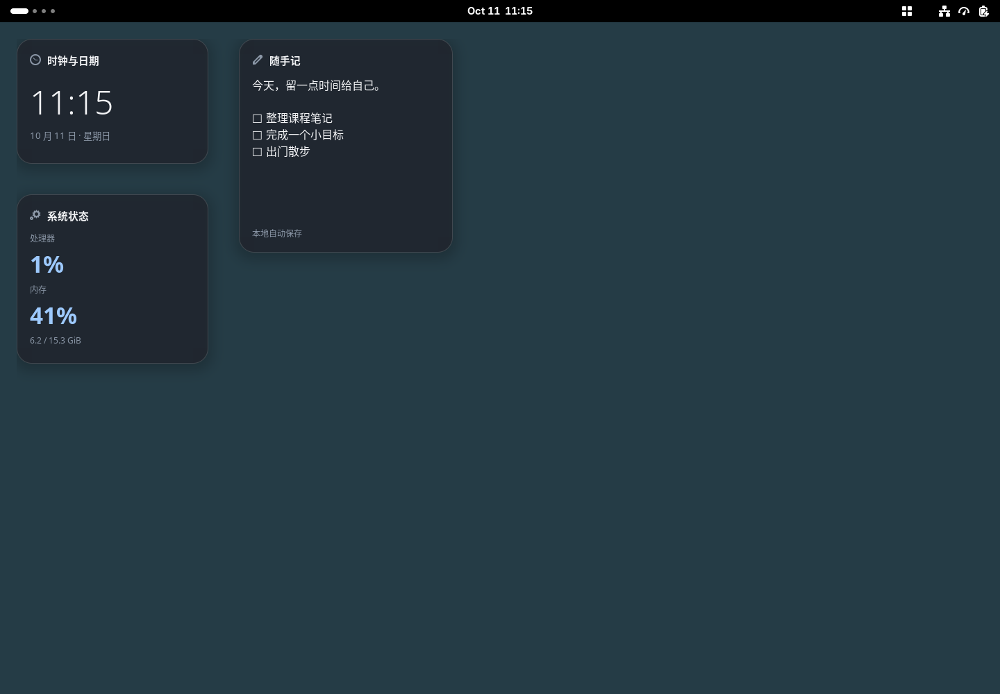

# 栖格 Perch

为 GNOME Shell 51 创建的轻量桌面组件扩展。中文界面，独立实现，GPL-3.0-only。

**当前版本：0.1.0-alpha.1。** 主屏首版，不是全功能稳定版；测试范围见 [验证记录](docs/VALIDATION.md)。



上图为隔离 GNOME 51 会话中的实际渲染；便签使用测试文字。

## 可以做什么

- 日期时钟、自动保存的便签、读取真实 `/proc` 数据的 CPU/内存监控。
- 从顶栏开关组件；隐藏便签保留内容。
- 编辑模式将组件临时移到窗口上方，支持标题拖拽、右下角缩放、网格吸附和碰撞约束。
- 编辑时聚焦组件标题，方向键移动，Shift + 方向键缩放；Esc 结束编辑。
- 明暗主题、跟随系统、半透明背景、秒数开关、监控刷新间隔。
- 屏幕尺寸变化后重新排布，放不下的组件暂时隐藏，保留原位置。
- 本地原子保存；未知数据版本或损坏文件进入保护状态，不覆盖原文件。

首版每种组件一个实例，只使用主显示器。多屏独立布局、多实例、天气、音乐、番茄钟、布局导入导出列在 [计划](docs/PLAN.md) 中。

## 安装

需要 GNOME Shell 51、GJS、GNOME Extensions 工具。设置窗口需要 GTK4/libadwaita。
系统监控使用 Linux `/proc`，无需额外服务；便签无需联网。

在仓库目录执行：

```sh
bash scripts/pack.sh
gnome-extensions install --force dist/perch@perilla.local.shell-extension.zip
```

保存手头工作后，注销并重新登录，然后启用：

```sh
gnome-extensions enable perch@perilla.local
gnome-extensions prefs perch@perilla.local
```

顶栏的网格图标是入口。第一次启动显示三张卡片；打开“编辑桌面布局”进行摆放，再按 Esc 完成。
桌面图标扩展可能挡住日常模式中的组件；编辑模式会抬高组件层级，但尚未保证与所有桌面图标扩展共存。

## 数据与恢复

- 偏好：GSettings `org.gnome.shell.extensions.perch`。
- 布局和便签：`${XDG_DATA_HOME:-~/.local/share}/perch/state.json`，文件权限 0600。
- 最多 16,000 个 Unicode 字符。便签是纯文本，不执行 Markdown 或代码。
- 关闭扩展前会提交最后一次保存；异步原子替换避免出现半份文件。
- “重置布局”不删除便签；扩展关闭时发出的重置请求会在下次启用时生效。
- 出现保存或读取错误时，顶栏菜单显示原因。读取失败进入只读保护；先备份原文件再排查，勿直接删除数据。

升级前建议备份 `state.json`。卸载扩展保留个人数据：

```sh
gnome-extensions disable perch@perilla.local
gnome-extensions uninstall perch@perilla.local
```

## 开发

```sh
bash scripts/check.sh
bash scripts/pack.sh
# 隔离真实 GNOME Shell 测试；参数必须是空目录的绝对路径
bash scripts/test-shell.sh /tmp/perch-shell-test
```

测试会话使用独立 XDG 配置、数据、缓存、运行目录和 D-Bus，总共约 20–45 秒。
它不安装到当前用户的正常扩展目录，也不启用当前桌面的扩展。
需要允许创建本地套接字及软件渲染；受限沙箱中可能无法启动。

测试入口会向隔离安装副本加入测试驱动，发布包不包含它。
布局及指标单元测试中的输入为明确构造的测试数据；桌面组件始终使用实际时钟和系统指标。
截图便签为测试文字，不是个人笔记。

## 文件导航

```text
extension.js       扩展启停、顶栏入口
prefs.js           GTK4/libadwaita 设置
stylesheet.css     卡片、主题和编辑模式
lib/desktop.js     桌面层、显示器变化和布局编辑
lib/card.js        卡片、鼠标手势和键盘操作
lib/layout.js      纯布局算法、状态格式验证
lib/store.js       本地状态加载、保存队列和错误保护
lib/io.js          异步文件操作
lib/system.js      系统数据采样生命周期
lib/metrics.js     CPU 和内存数据计算
widgets/index.js   首版三个组件
schemas/           GSettings 定义
tests/             单元、GJS 文件持久化和真实 Shell 测试
scripts/           检查、打包、隔离测试
docs/              计划、验证记录
```

使用 `main` 保存已验证里程碑，`feat/*`、`fix/*` 开发；每个发布版本打标签。
编译产物及安装包不进入 Git。当前仓库只在本地管理，没有远程仓库。

## 来源

参考 [Gridgets](https://github.com/rebatnaath/gridgets) 的桌面网格交互，未复制其组件源码或视觉资源。
API 以本机 GNOME Shell 51 和 [官方迁移指南](https://gjs.guide/extensions/upgrading/gnome-shell-51.html) 为依据。
桌面层级依赖一处 Shell 私有背景组引用，升级到后续 Shell 大版本时需要重新验证。
