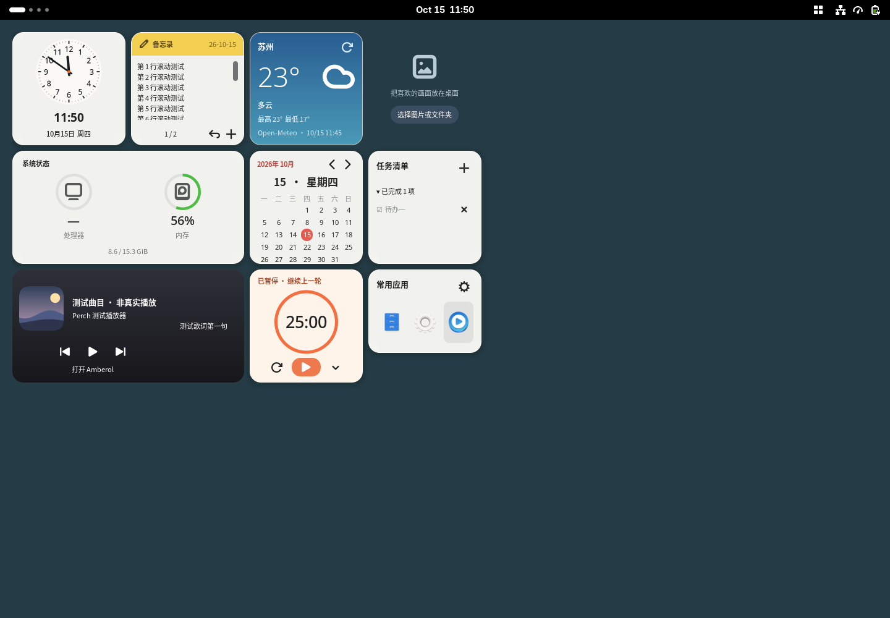

# 栖格 Perch

为 GNOME Shell 51 创建的轻量桌面组件扩展。中文界面，独立实现，GPL-3.0-only。

**当前版本：0.4.0-alpha.1。** 主屏预览版；测试范围见 [验证记录](docs/WORKFLOWS-VALIDATION.md)。



上图为隔离 GNOME 51 会话中的实际渲染；天气来自苏州的真实请求，音乐为模拟播放器；笔记、任务与图片是测试内容，不是个人数据。

## 可以做什么

- 十类组件：指针/数字时钟、便签、CPU/内存监控、月历、番茄钟、音乐、天气、照片、任务和应用启动器。
- 按目标尺寸原生排版，字体不再随整层纹理缩放；默认大小为 75%，2×2 方卡约 183×183 逻辑像素；在设置中可整体调整为 50%–125%。
- 拖拽时连续跟随鼠标，只在松手后吸附网格；碰撞时回到原位。
- 备忘录最多保存 20 条独立笔记，底部 + 新建、序号菜单切换；撤销按钮或 Ctrl+Z 撤销当前笔记的编辑，保留最近 20 个编辑批次，重载后仍可撤销。连续输入会合并为一个批次。可选择弹窗或直接在组件内编辑，长文本可滚动；回车完成，Ctrl+回车换行，自动保存。预览正文左对齐，弹窗标题为“备忘录”；可显示最后修改日期 yy-mm-dd；保留纯文本编辑，不渲染 Markdown。
- 任务回车创建，完成项默认折叠为“已完成 N 项”，点击展开；删除后可点击“撤销删除”，保留最近 20 次删除记录，重载后仍可恢复。最多 100 条。应用启动器支持最多九个应用，普通模式直接拖动图标排序，拖动不会启动应用；可隐藏名称，图标大小和列数按数量与卡片空间调整，卡片默认按应用数量自动调整尺寸；手动缩放会关闭自动尺寸，也可在设置中切换；显示名称和仅图标分别保存手动尺寸，切换时恢复。
- 从顶栏开关组件；弹出菜单以图标为中心对齐，靠屏幕边缘时自动避让。点击系统状态打开系统监视器；月历日期支持悬停提示，点击回到今天。隐藏便签保留内容。
- 编辑模式将组件临时移到窗口上方，支持标题拖拽、右下角缩放、网格吸附和碰撞约束。
- 编辑时聚焦组件标题，方向键移动，Shift + 方向键缩放；Esc 结束编辑。
- 明暗主题、跟随系统、半透明背景、秒针开关、监控刷新间隔。
- 参考 macOS 原生组件重新设计：完整指针钟面、黄色页眉备忘录、绿色设备状态环；普通状态隐藏编辑工具栏。
- 新布局采用三列卡片组合，音乐和系统状态占双列，间距 12 像素。升级保留旧布局，可在设置中重置布局采用新排列，便签内容保留。
- 卡片、菜单和设置明确使用简体中文区域字体，避免日韩字形回退。
- 屏幕尺寸变化后重新排布，放不下的组件暂时隐藏，保留原位置。
- 本地原子保存；旧版布局自动补充新组件的位置，保留已有位置与便签；未知数据版本或损坏文件进入保护状态，不覆盖原文件。

照片可额外创建最多八个独立相框，其余组件各一个实例。只使用主显示器，多屏独立布局和布局导入导出仍列在 [计划](docs/PLAN.md) 中。

## 照片与尺寸

打开“外观与设置 → 组件”，展开“照片”；独立相框也在组件页中。每种组件的尺寸和功能设置均放在其子项内，关闭组件后子项禁用。

- 编辑布局时，相框左下角垃圾桶可移除该相框，保留原图；主相框会隐藏，可从设置重新开启。
- **独立相框 → 新增相框**：选择图片或文件夹，新相框分别保存尺寸、位置、裁切和轮播偏好；移除相框不删除原图。
- **选择图片**：显示一张本地图片；**选择文件夹**：按文件名自然顺序轮播，选择成功会自动开启照片组件。
- 支持 PNG、JPEG、WebP、BMP、GIF（首帧，具体格式取决于系统解码器）。间隔 5–3600 秒，默认 30 秒；相框内可上一张、下一张和暂停，暂停状态会保存。
- **填满卡片**居中裁切；**完整显示**保留原图比例和深色留白。两种模式均有圆角，不拉伸原图。
- 仅读取所选目录第一层，跳过隐藏文件、子目录、链接及大于 64 MB 的文件；最多取 500 张，扫描上限 5000 个条目。坏图自动尝试跳过；空文件夹、路径不可用会明确提示。
- 支持文件夹变动监视，增删图片后刷新；不支持文件监视的文件系统可重新选择来源刷新。关闭组件会停止轮播并取消尚未完成的读取，不复制、不上传原图。
- 所有组件均有适配内容的尺寸规格，同时保留编辑模式下的自由拖拽缩放。

尺寸按 **宽 × 高** 表示。在整体大小为 100% 时，每单位是 128 个逻辑像素（含间距）：2×2 卡片实际约 244×244，3×3 约 372×372，2×4 为竖版约 244×500，4×2 为横版约 500×244；默认 75% 时上述尺寸再乘 0.75，HiDPI 随桌面缩放。

| 组件 | 可选规格 |
|---|---|
| 时钟、番茄钟 | 2×2、3×3 |
| 便签 | 2×2、3×3、2×4、4×2 |
| 照片 | 1.5×1.5、2×2、3×3、2×4、4×2 |
| 任务 | 2×2、3×3、2×4 |
| 应用启动器 | 2×1.5、2×2、3×2、3×3、4×2 |
| 系统状态 | 2×2、3×3、4×2 |
| 月历、天气 | 2×2、3×3、2×4 |
| 音乐 | 3×3、4×2 |

在尺寸下拉框选择后即发出调整请求，框会回到“选择尺寸…”，方便再次选择。桌面编辑标题栏显示实际尺寸。扩大组件会先寻找附近空位，不挪动其他组件；空间不足时提示并保留原布局。旧便签、倒计时和位置保留。

## 其他组件

| 组件 | 功能与外观 |
|---|---|
| 月历 | 周一为每周起点，红色圆点标记今天；箭头切换月份，点击大日期回到本月。仅显示日期，不接入个人日程。 |
| 番茄钟 | 暖橙色进度环，暂停后显示“继续上一轮”；左侧按钮展开“开始新一轮”，确认后立即重新开始专注；默认专注 25 分钟、休息 5 分钟，可在设置修改。开始按钮右侧的展开按钮提供 5/10/15/25/30/50 分钟档位，选择档位重置当前计时为所选专注时长。设置中的结束提醒可选“仅通知”或“通知和提示音”；点击开始进入下一阶段。 |
| 音乐 | 默认打开 Amberol，可在“组件 → 音乐”中选择其他播放器。点击封面或底部入口启动/切换应用，空闲时播放按钮也可启动；已有播放器则通过 MPRIS 播放/暂停和切歌。多个播放器时底部可切换控制目标。 |
| 天气 | 蓝色渐变、当前气温、天气与当日高低温。默认江苏苏州，每 15 分钟更新，可手动刷新或在设置搜索其他城市。 |

音乐读取 MPRIS 的本地封面并据此调整背景色，以约 320ms 平滑过渡；使用受限深色背景和白色文字，保证文字与背景至少 4.5:1 对比度，歌词宽度随卡片调整；没有封面时显示中性图标。歌词来自播放器 `xesam:asText` 或本地歌曲旁同名 UTF-8 `.lrc` 文件，带时间戳时按播放器 Position 同步，歌词显示在卡片右侧，没有歌词时完全隐藏，不显示播放状态文字。当前不下载远程封面或在线歌词，不保证所有播放器提供歌词/播放位置。

番茄钟使用持久化截止时间：切换主题、隐藏组件、重启扩展、休眠期间均继续计时。隐藏或禁用期间不发送完成通知，重新显示后检查到期状态；修改系统时间可能影响倒计时。修改时长在重置或下一阶段生效。

天气使用 [Open-Meteo](https://open-meteo.com/) 的模型数据（不是本地传感器实测），不需要 API Key。当前时间戳显示在卡片底部。更新失败时明确提示；若本次 Shell 会话已有缓存则标记“旧数据”，没有缓存不显示虚构气温。关闭天气组件停止请求。搜索城市会发送输入的城市名称，查询天气会发送所选坐标，不读取 GPS 或自动定位。默认免费接口适用于非商业使用；分发为商业产品前需核对服务条款。

## 安装

需要 GNOME Shell 51、GJS、GNOME Extensions 工具。设置窗口需要 GTK4/libadwaita，天气请求使用 libsoup 3，照片需要 GdkPixbuf 及对应图像解码器。
系统监控使用 Linux `/proc`，无需额外服务；便签无需联网。
推荐安装 `Noto Sans CJK SC`（Arch/CachyOS 包名 `noto-fonts-cjk`）。字体选择也支持思源黑体 SC/CN 和文泉驿微米黑；仅使用系统通用字体可能出现区域字形差异。

在仓库目录执行：

```sh
bash scripts/pack.sh
gnome-extensions install --force dist/perch@perilla.local.shell-extension.zip
```

保存手头工作后，注销并重新登录，然后启用：

```sh
gnome-extensions enable perch@perilla.local
gnome-extensions prefs perch@perilla.local
```

顶栏的网格图标是入口。第一次启动显示九张卡片，照片在选择来源后启用；屏幕空间不足时部分组件暂时隐藏；打开“编辑桌面布局”进行摆放，再按 Esc 完成。
桌面图标扩展可能挡住日常模式中的组件；编辑模式会抬高组件层级，但尚未保证与所有桌面图标扩展共存。

## 数据与恢复

- 偏好：GSettings `org.gnome.shell.extensions.perch`。
- 布局和便签：`${XDG_DATA_HOME:-~/.local/share}/perch/state.json`，文件权限 0600。
- 最多 16,000 个 Unicode 字符。便签是纯文本，不执行 Markdown 或代码。
- 关闭扩展前会提交最后一次保存；异步原子替换避免出现半份文件。
- “重置布局”不删除便签；扩展关闭时发出的重置请求会在下次启用时生效。
- 出现保存或读取错误时，顶栏菜单显示原因。读取失败进入只读保护；先备份原文件再排查，勿直接删除数据。

升级前建议备份 `state.json`。卸载扩展保留个人数据：

```sh
gnome-extensions disable perch@perilla.local
gnome-extensions uninstall perch@perilla.local
```

## 开发

```sh
bash scripts/check.sh
bash scripts/pack.sh
# 隔离真实 GNOME Shell 测试；参数必须是空目录的绝对路径
bash scripts/test-shell.sh /tmp/perch-shell-test
```

测试会话使用独立 XDG 配置、数据、缓存、运行目录和 D-Bus，总共约 90–150 秒。
它不安装到当前用户的正常扩展目录，也不启用当前桌面的扩展。
需要允许创建本地套接字及软件渲染；图片测试还需要系统图像解码器的辅助进程与本地会话支持，受限沙箱中可能无法启动。

测试入口会向隔离安装副本加入测试驱动及明确标注的模拟 MPRIS 播放器，发布包不包含它们。音乐控制通过真实 D-Bus 调用测试服务验证；第三方播放器仍需实际使用验收。可执行 `gjs -m tests/weather-live.gjs.js` 单独验证苏州实时服务连接（需要网络）。
布局及指标单元测试中的输入为明确构造的测试数据；桌面组件始终使用实际时钟和系统指标。
截图便签为测试文字，不是个人笔记。

## 文件导航

```text
extension.js       扩展启停、顶栏入口
prefs.js           GTK4/libadwaita 设置
stylesheet.css     卡片、主题和编辑模式
lib/desktop.js     桌面层、显示器变化和布局编辑
lib/card.js        卡片、鼠标手势和键盘操作
lib/layout.js      纯布局算法、状态格式验证
lib/store.js       本地状态加载、保存队列和错误保护
lib/io.js          异步文件操作
lib/system.js      系统数据采样生命周期
lib/metrics.js     CPU 和内存数据计算
lib/typography.js  简体中文字体选择与文本语言属性
widgets/          十种组件的界面与交互
lib/photos.js     异步图片扫描、解码、适配和圆角
lib/sizes.js      组件尺寸规格和不挤占布局的调整
lib/mpris.js      本机播放器发现、状态和控制
lib/weather.js    天气与城市查询客户端
lib/widget-models.js  月历、计时、天气数据模型
schemas/           GSettings 定义
tests/             单元、GJS 文件持久化和真实 Shell 测试
scripts/           检查、打包、隔离测试
docs/              计划、验证记录
```

使用 `main` 保存已验证里程碑，`feat/*`、`fix/*` 开发；每个发布版本打标签。
编译产物及安装包不进入 Git。当前仓库只在本地管理，没有远程仓库。

## 来源

参考 [Gridgets](https://github.com/rebatnaath/gridgets) 的桌面网格交互，未复制其组件源码或视觉资源。
API 以本机 GNOME Shell 51 和 [官方迁移指南](https://gjs.guide/extensions/upgrading/gnome-shell-51.html) 为依据。
视觉参考 [Apple 的桌面组件说明](https://support.apple.com/en-gb/guide/mac-help/mchl52be5da5/mac)，使用独立配色、图标与实现。
桌面层级依赖一处 Shell 私有背景组引用，升级到后续 Shell 大版本时需要重新验证。
